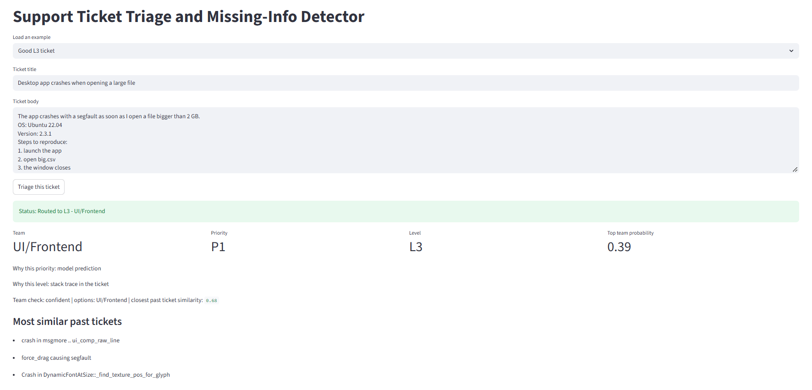
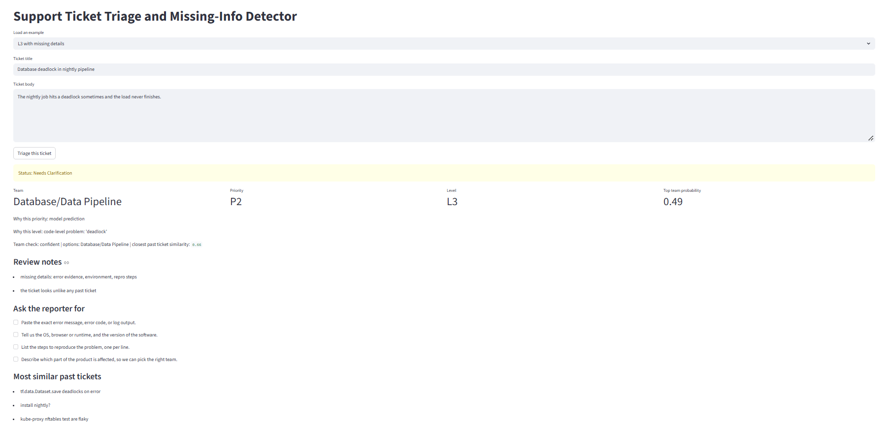
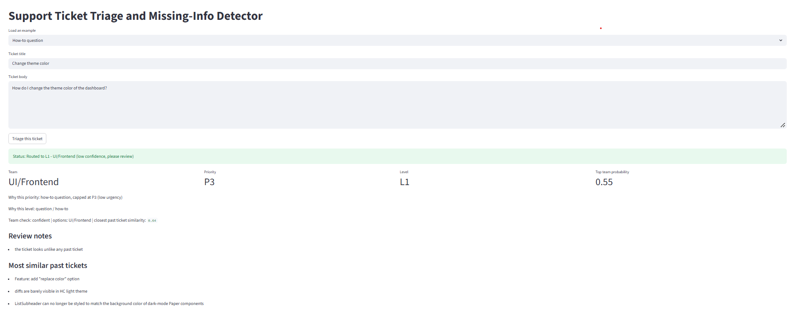
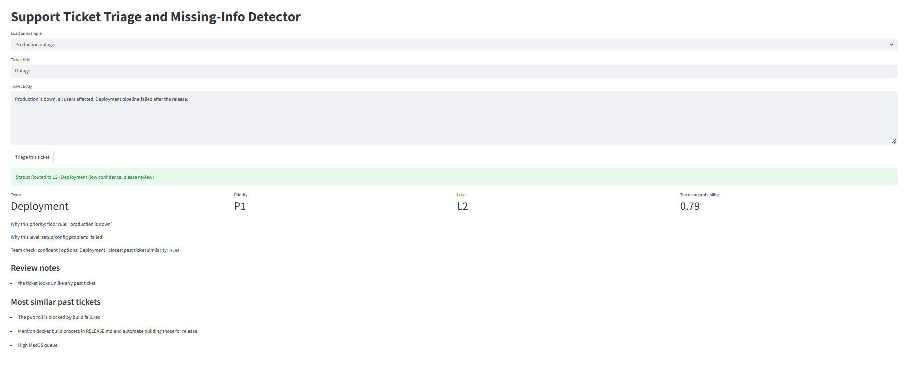
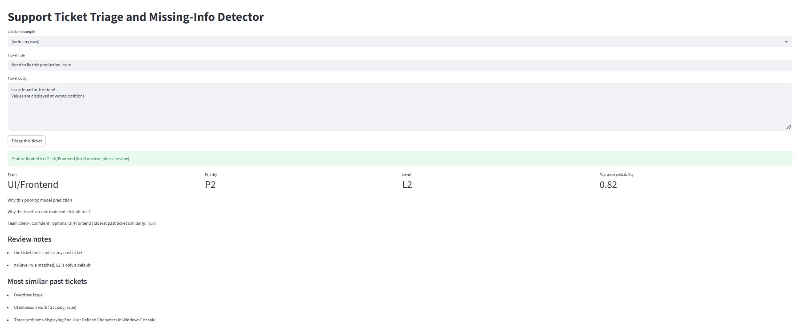
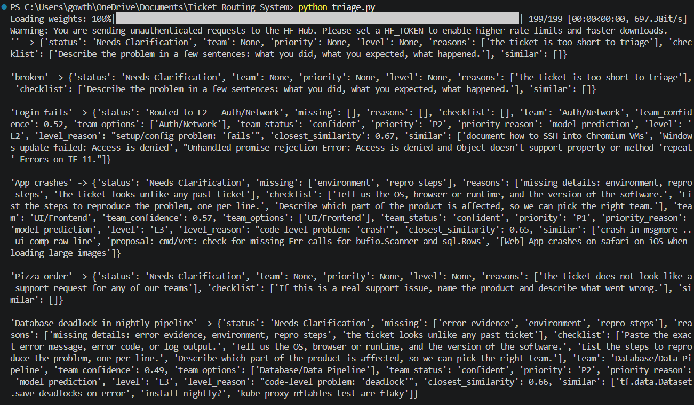
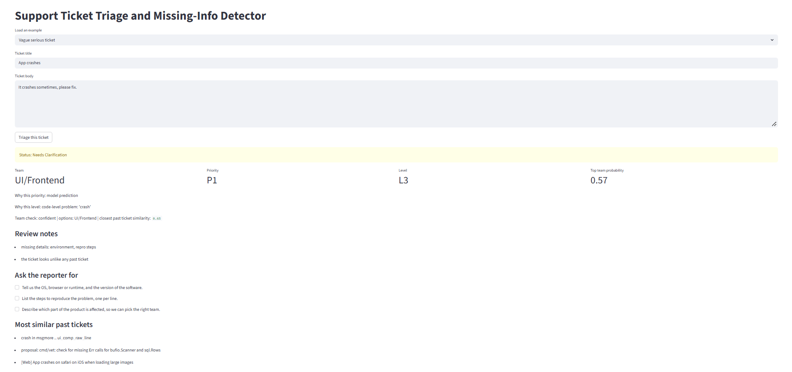
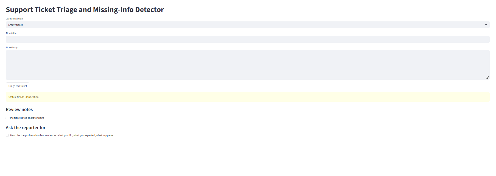
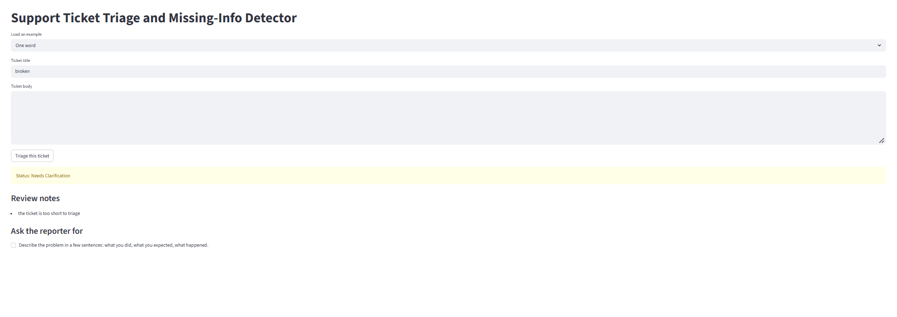
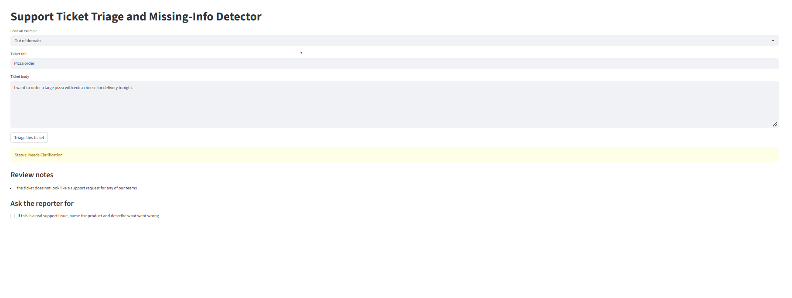

# Intelligent Support Ticket Triage & Missing-Info Detector

Repository: [Intelligent-Support-Ticket-Triage-Missing-Info-Detector](https://github.com/GowthamSenthilKumarGSK/Intelligent-Support-Ticket-Triage-Missing-Info-Detector)

**Track:** AI / NLP and Smart Routing

A local Python app that reads a support ticket and decides:

- **Team** that should get it: Auth/Network, Database/Data Pipeline, Deployment or UI/Frontend
- **Priority:** P1, P2 or P3
- **Level:** L1, L2 or L3 (how deep the technical work is)
- **Whether it can be routed now**, or whether the reporter must first send more information (the **Information Gap and Misrouting Guard**)

---

## Architecture 

- **Frozen Embeddings + Small Classifiers:** I use `bge-base-en-v1.5` to convert each ticket into a vector. Then, two Logistic Regression models predict the team and priority. We have around 900 labelled tickets, so this approach is faster and more suitable than fine-tuning a large model.
- **Confidence Check:** I use Conformal Prediction to check how many teams could be suitable for a ticket. We also use a Nearest-Neighbour check to see how similar the ticket is to previous tickets. If the system is not sure, it can say "not sure" instead of giving a wrong answer confidently.
- **Priority and Level are Separate:** Priority tells us how urgent the ticket is, while L1/L2/L3 tells us how technically difficult it is. Priority is predicted by the model, but clear cases like outage, data loss, or breach can directly make the ticket P1. The level is decided using rule-based checks.
- **Information Gap + Misrouting Guard:** For L3 tickets, the system checks whether important details like error evidence, environment, and reproduction steps are available. If something is missing or the team is uncertain, it gives Needs Clarification and shows what information is required.
- **Explainable Decisions:** The app shows which rule was triggered, what information is missing, and which previous tickets are most similar. The rules are kept in `rules.py` and `guard.py`, so a reviewer can understand why the system made that decision.

---

## Models used

- **Embedding model:** `BAAI/bge-base-en-v1.5` (768-dimensional vectors, ticket text cut at 256 tokens)
- **Classifiers:** scikit-learn `LogisticRegression` with balanced class weights, one for team and one for priority
- **Confidence:** conformal prediction at 90% coverage (alpha 0.1), plus cosine similarity to the 5 nearest training tickets
- **Everything else** (level, guard, priority floor): hand-written rules, no model

---

## Screenshots

### Normal cases

**Good L3 ticket** (all details present, routed to L3)



**L3 ticket with missing details** (held back, checklist generated)



**How-to question** (routed to L1, priority capped at P3)



**Production outage** (P1 from the safety floor)



**Write my own** 



**Command-line run**



### Edge cases

**Vague serious ticket**



**Empty ticket**



**One-word ticket**



**Out-of-domain ticket** (a pizza order)



---

## Future work

I ran out of time for a few things that were in my original plan.

- **Zero-shot level labelling:** Right now L1/L2/L3 comes from keyword rules. I wanted to use a zero-shot NLI model (BART-MNLI or the DeBERTa-v3 zero-shot model) to label levels from short descriptions of each level, and then train a small level classifier on those labels. I would check it against a hand-labelled set of tickets.
- **Fine-tuning the embedder:** I would fine-tune the embedding model on the team labels with a contrastive method such as SetFit, and try a larger model such as Qwen3-Embedding if a GPU is available. It was too slow on a CPU for this deadline.
- **Reading prose in the guard:** The guard finds the environment and repro steps with patterns, so it misses setups described in plain sentences. An NLI model could read those and decide whether the ticket really describes steps to reproduce.
- **A human-audited test set:** The team and priority labels are weak labels. I held out 200 tickets for a blind audit, which would give real test numbers and a better calibration set for the confidence thresholds.
- **Better priority labels:** Priority in this data is mostly bug versus feature request. With real urgency labels, or a rubric based on impact and number of users affected, the priority model could be much better than 0.67 accuracy.
- **Learned thresholds:** The 0.5 probability cut-off for the out-of-domain check was chosen by hand. It should be learned from data.

---

## How to run

```
pip install -r requirements.txt
python prepare_data.py      # cleans data/tickets_clean.csv, adds signals, writes data/tickets_ready.csv
python train_model.py       # embeds tickets, trains the team and priority heads
python confidence.py        # calibrates the confidence thresholds
streamlit run app.py        # opens the interface
python triage.py            # same pipeline, in the terminal
```

---

## Data

- **Source:** the public Hugging Face dataset `sharjeelyunus/github-issues-dataset` (about 114,000 GitHub issues). We sampled and cleaned **905 tickets**.
- **Splits:** 665 train, 200 held out of training, 40 kept for the demo.
- **Labels:** team and priority are **weak labels** derived from the issues' own labels and repository rules, not hand-written support labels.
- **Detail signals** (error code, environment, repro steps, logs) are found by pattern matching in `signals.py`. We checked them against the issue-template fields on the 571 tickets that have a template:

| Signal | Agreement | Precision | Recall |
|---|---|---|---|
| Environment | 0.81 | 0.73 | 0.92 |
| Repro steps | 0.84 | 0.86 | 0.75 |
| Logs | 0.86 | 0.75 | 0.50 |

About 11% of tickets contain an error code or exception name and 7% contain a stack trace.

---

## Results

Measured by **5-fold cross-validation** on the 665 training tickets:

| Head | Accuracy | Macro F1 |
|---|---|---|
| Team | 0.863 | 0.867 |
| Priority | 0.668 | 0.641 |

On 240 tickets the model had not trained on, the conformal check found **209 confident (87%)**, 30 ambiguous and 1 out of distribution. Only 4.6% looked unlike any training ticket. These thresholds were calibrated on out-of-fold training predictions.

---

## Limitations

- **Priority is the weakest part:** The priority labels come mostly from "bug versus feature request", so P2 versus P3 is hard to separate (accuracy 0.67). P1 predictions are only 39% precise, which is why only explicit floor rules trigger immediate escalation, and why how-to questions are capped at P3.
- **Level rules are keyword-based:** and can over-assign L3 when a ticket contains a word like "crash". A ticket that matches no rule gets the default L2 and is flagged "level unclear, please review".
- **Short tickets:** look unlike the long training tickets, so they are often flagged for review. The out-of-domain rule fires only when a ticket also contains no technical cue and has a top team probability under 0.5. That 0.5 cut-off was chosen by hand, not learned from data.
- **"Confident:"** means the conformal set holds exactly one team. The probability shown is the model's top score, and it can be modest even when the answer is confident.
- **Environment detection:** misses some tickets that describe their setup in plain prose.
- **Calibration:** uses cross-validated training predictions, and the labels are weak, so the reported numbers measure agreement with those labels, not with human judgement.

---

## Files

| File | Purpose |
|---|---|
| `signals.py` | finds error codes, environment, repro steps and logs in a ticket |
| `check_signals.py` | compares those signals with the issue-template fields |
| `prepare_data.py` | cleans the data and adds the signal columns |
| `train_model.py` | embeds tickets and trains the team and priority heads |
| `confidence.py` | conformal and nearest-neighbour confidence |
| `rules.py` | priority safety floor and level rules |
| `guard.py` | the Information Gap and Misrouting Guard |
| `triage.py` | the full pipeline for one ticket |
| `app.py` | Streamlit interface |
